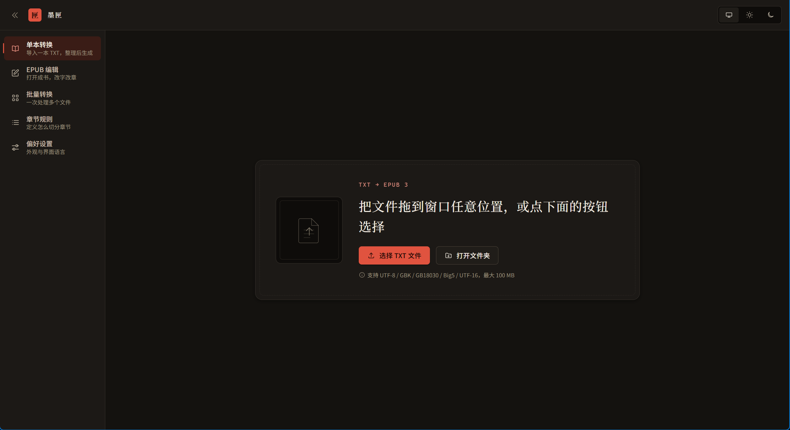

# 墨匣

把 TXT 小说转成 EPUB 电子书，也能对已有的 EPUB 做修改。



> Windows 免安装版下载：见 [Releases](https://github.com/wan-ans/txt2epub/releases)。

## 功能

**转换**
- 拖拽或选择 TXT（支持一次导入多个 / 整个文件夹）
- 自动检测编码（UTF-8 / GBK / GB18030 / Big5 / UTF-16 / Shift_JIS）
- 自动分章：内置 8 条规则覆盖「第N章 / 第N节 / 第N回 / 第N卷 / Chapter N / 序章 / 楔子 / 后记 / 番外」等常见标题格式
- 自定义章节规则：正则或关键词，可实时预览命中行数、启用停用、排序、导入导出 JSON

**EPUB 编辑**
- 打开已有 EPUB（EPUB 2 / 3）或新建空白书
- 书籍信息：书名、副标题、作者、语言、出版方、出版日期、简介、标签；原书 dc:identifier 保留
- 章节：搜索、新增、删除（二次确认）、上移 / 下移、拖拽排序；拖入 TXT / EPUB 可直接追加章节；目录 nav / NCX 自动同步
- 正文富文本编辑：标题 H1–H3、加粗、斜体、下划线、删除线、引用、有序 / 无序列表、链接、图片、清除格式；500ms 防抖自动保存
- 编辑字号与行距：字号 12–32px、行距 1.2–2.4（仅影响界面预览，不写入导出 EPUB）；侧栏收起后正文区域自动变宽
- 格式工具栏可收起；保存按钮为右下角悬浮按钮，鼠标靠近自动展开
- 封面：替换 / 移除，保留原封面资源
- **增量写回**：只重写你改过的章节，未编辑章节与图片、字体、CSS 等资源原样保留；导出产物通过 EPUBCheck

**编辑**
- 章节列表支持搜索、虚拟滚动
- 重写章节标题、与上一章合并
- **编辑正文**
- **追加章节**：把零散 TXT 拖进章节区（或点「打开文件」）即可作为新章节并入当前书，适合多文件合并；追加内容按文件名自然序接在主文件之后，主文件原有顺序不受影响
- 书籍元信息：书名、作者、语言、简介、标签
- 封面：JPG / PNG / WEBP，带预览
- 排版：首行缩进、行高、字号、段间距，右侧实时预览效果

**界面**
- 三处可独立收起，互不联动：左侧主导航（`Ctrl+B`）、章节列表（`Ctrl+Shift+B`）、右侧设置面板
- 正文区域随侧栏收起自适应变宽；章节预览支持字号 / 行距调节（与排版导出设置联动）
- 打开文件后默认收起左侧主导航与右侧书籍信息面板，把空间留给章节与正文
- 右侧设置面板收起后，恢复入口出现在正文工具栏最右侧
- 标题栏「退出本书」可随时回到开始换下一本；导出成功后也有「完成，换下一本」按钮

**批量**
- 一次选多个 TXT 或扫整个文件夹，各生成一本 EPUB
- **合并为一个文件**：打开该开关后，下方列表变为章节排序表 —— 可拖动行或用 ↑↓ 调整顺序，最终按此顺序合并输出一本；导入时会按文件名自动排序一次（数字按大小，`1 → 2 → 10` 而非字符序）
- **合并模式下可直接改章节标题**：点标题即可编辑，回车保存、Esc 取消；已改过的标题用朱砂色标出并带「恢复为文件名」按钮，也支持一键全部恢复。只切出一章的文件用整个名字，会拆成多章的文件则作为章节前缀（如「卷一 · 第1章」）

**输出**
- 生成标准 EPUB 3.0，含目录、封面、书名页、排版样式表
- 产物通过 W3C 官方 EPUBCheck 校验（0 error / 0 warning）

## 上手

```bash
npm install
npm run dev:desktop      # 开发模式：Vite + Electron 一起起
```

## 构建

```bash
npm run build:web        # 只产出前端 dist/
npm run dist:dir         # 打包成免安装目录 release/win-unpacked/
npm run dist             # 打包成 NSIS 安装包（需联网下载工具）
```

> 如果本机 shell 里存在 `ELECTRON_RUN_AS_NODE=1`，`electron.exe` 会退化成纯 Node，
> 报 `Cannot read properties of undefined (reading 'isPackaged')`。启动脚本里已自动清除，
> 手动运行前请先 `Remove-Item Env:ELECTRON_RUN_AS_NODE`。

## 测试

```bash
npm test -- --run        # 294 个单元/集成测试
npm run typecheck        # vue-tsc 类型检查
```

EPUB 产物的校验：

```bash
node tools/gen-sample-epub.mjs                     # 用真实小说生成样书
node tools/validate-epub.mjs "tools/sample-output/*.epub"   # EPUBCheck 校验
```

## 项目结构

```
src/core/         纯逻辑：编码检测、章节解析、EPUB 生成、EPUB 解析与增量写回（无 Vue；epubPackage 使用标准 DOMParser）
src/components/   Vue 组件（layout / panels / epub / ui / icons）
src/styles/       设计令牌 tokens.css + 全局样式 app.css
electron/         主进程、preload 桥接、IPC
tools/            验证脚本（EPUBCheck 校验、E2E 导出、截图）
tests/fixtures/   真实测试小说（UTF-8 与 GBK 各一）
docs/CONTRACT.md  模块边界与函数签名契约
```

## 验证脚本

| 脚本 | 作用 |
| --- | --- |
| `tools/validate-epub.mjs <file.epub>` | 用 W3C 官方 EPUBCheck 校验产物结构 |
| `tools/e2e-export.cjs` | 真实 UI 点击导出 → 拦截字节 → 落盘（验证端到端导出链路） |
| `tools/e2e-features.cjs` | 书名即时保存、章节追加、批量合并排序的 22 项功能断言 |
| `tools/verify-merge-output.mjs` | 验证合并产物里各文件正文顺序与队列顺序一致 |
| `tools/e2e-rename.cjs` | 合并模式改名的 10 项交互断言（改名/取消/恢复/批量恢复） |
| `tools/verify-rename-output.mjs` | 验证改过的标题真的写进了 EPUB 目录 |
| `tools/e2e-layout-edit.cjs` | 面板收起/独立折叠/退出本书/正文编辑的 22 项交互断言 |
| `tools/e2e-inline-edit.cjs` | 正文内联编辑 10 项断言（光标落位、就地删改、自动保存） |
| `tools/e2e-blank-stability.cjs` | 多轮保存后行数/空行不漂移 |
| `tools/e2e-wheel-scroll.cjs` | 正文滚轮滚动（聚焦 / 未聚焦 / 窄窗口）8 项断言 |
| `tools/verify-body-edit-output.mjs` | 验证正文删减真的反映在导出产物里 |
| `tools/e2e-real-app.mjs` | 用真实主进程启动，核对 preload 桥接与 CSP |
| `tools/gen-epub-fixture.mjs` | 生成用于 EPUB 编辑验收的真实结构样书 |
| `tools/e2e-epub-edit.cjs` | EPUB 编辑端到端验收（导入 / 改元信息 / 改章 / 排序 / 导出 / 重开） |

> Electron 相关脚本运行前若报 `isPackaged` 错误，先清掉本机环境变量 `ELECTRON_RUN_AS_NODE`。

## 设计说明

- **配色与字号全部集中在 `src/styles/tokens.css`**，组件内不写字面量颜色，浅色/深色共用一套令牌
- 浅色正文对比度 18.82:1，深色 14.28:1，交互控件边框均 ≥ 3.55:1
- 支持 `prefers-reduced-motion`；键盘 Tab 可达，focus 有明显描边

产物结构：

```
mimetype                    ← 首条目且 STORE（EPUB 规范硬性要求）
META-INF/container.xml
OEBPS/content.opf           ← OPF 3.0
OEBPS/nav.xhtml             ← 目录（properties="nav"）+ landmarks
OEBPS/toc.ncx               ← 兼容老阅读器（可选）
OEBPS/style.css             ← 由排版选项生成
OEBPS/cover.xhtml + images/ ← 有封面时
OEBPS/chapter-001-*.xhtml   ← 正文，文件名已剔除空白与 URI 非法字符
```

## 致谢

章节识别思路参考了 [bluicezhen/txt-to-epub](https://github.com/bluicezhen/txt-to-epub)（MIT）。

## 许可

MIT